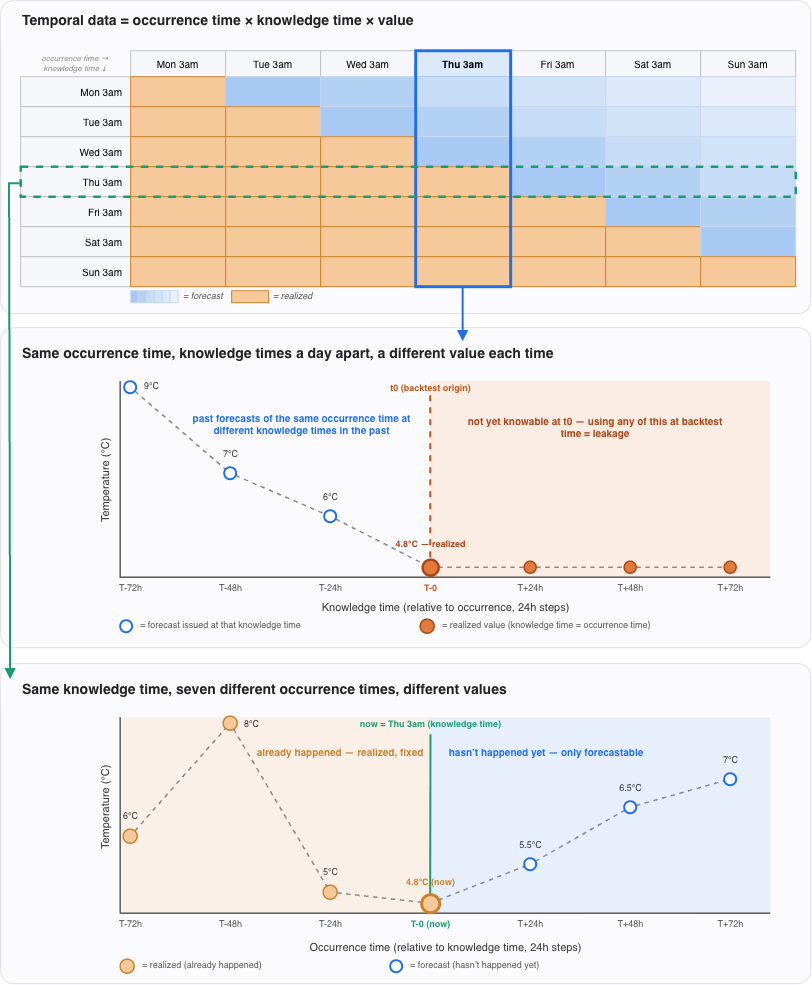
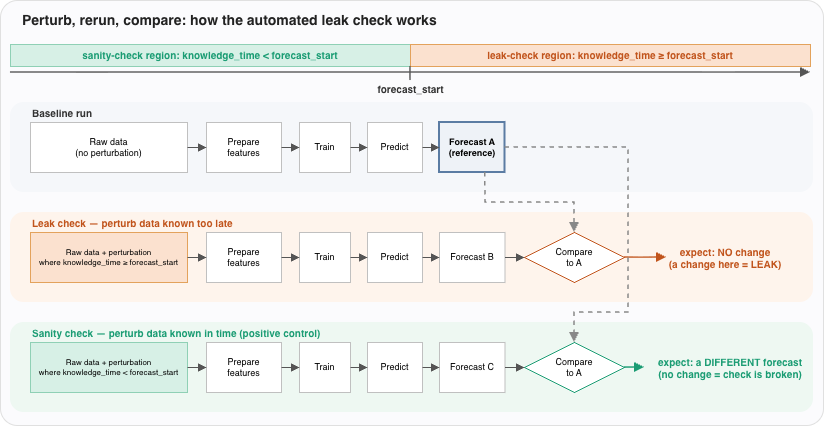

*Originally published on the [Xebia blog](https://xebia.com/blog/spotting-leakage-before-it-wrecks-your-backtest/).*

I recently worked on a demand forecasting use case for a customer in the energy domain. One of the main goals of the project was to assess the feasibility and expected performance of the forecasting model when compared to historical data. My colleague **Max van den Hoven** summarized the main learnings from that project in [this post](https://xebia.com/blog/7-practical-tips-for-demand-forecasting-experimentation-and-modeling/), which I recommend reading.

For that assessment we built a backtesting pipeline, which answers the question of how well your model is going to perform in production.
A backtest does it by replaying history. The model is trained on the data available up to a certain moment, then we forecast the period that follows and
compare that forecast against what actually happened.
The numbers that come out of a backtest drive real decisions:
which features to keep, which parameters to tune, and whether the model is good enough to be used.

All of it depends on one important assumption: that the backtest reflects reality. When it does not, it tends to lie to
us with overoptimistic results. The model looks better in the backtest than it can ever be in
production, and the gap shows up after a while, when the model is already being used.

There are a few reasons for a backtest to drift away from reality. Distribution shift and new seasonal effects
are the familiar ones. A nastier one is temporal leakage: knowledge from the future making its way into a
process that is meant to run in the past. A backtest requires the model to live in the past, but the evaluator to live in the present.
The model is only allowed to use what was knowable right before the forecast starts, and everything from the
forecast window onwards exists only to score the model against it. If any of that
later data becomes visible to the model, it gains an advantage that it will never have in production, and the
evaluation metrics stop meaning what we think they mean.

In this post we will focus on an automated method to detect leakage in time series being fed into a forecasting
model, not just as an audit but as a regression test that could run in your CI pipeline.

## Temporal Data

From a forecasting perspective, every temporal data point has two time attributes:

* **Occurrence time**: at what time the data value occurs. e.g. 3 am CET on Wednesday 3rd of September 2026.
* **Knowledge time**: at what time was the value known.

Based on that, we can define a few types of data:

* **Realized or past**: data in which `occurrence_time <= knowledge_time`. The actual values known after the fact. e.g., weather measurements.
* **Vintage or point-in-time**: data in which `occurrence_time > knowledge_time`. The weather forecast for the coming 3 days as known today.
* **Known future**: data for which we have complete perfect knowledge about the future. Can be defined as a **vintage** with a `knowledge_time == -∞`.


*The same weather source read along two different axes. Fix an occurrence time (middle) and the value keeps moving as newer forecasts arrive, until the realized measurement freezes it for good. Fix a knowledge time (bottom) and you get what was actually on the table at that instant: realized to the left, forecast to the right. Only the second reading is available to a model that has to run at `t0 + 1`.*

Training and running a forecasting model usually involves some or all of the previous data to be shaped into a feature that the model can consume.
When backtesting, we define a training period `[training_start, forecast_start)` and a forecasting period `[forecast_start, forecast_end]`, and it is of great importance that
all the data that the model gets access to (during training or backtesting) complies with the rule `knowledge_time < forecast_start`. Any violation of that rule can lead to leakage.

> **"Leakage is any violation of `knowledge_time < forecast_start`."**

## Leakage Detection

A model being backtested on the forecasting period `[forecast_start, forecast_end]` should never see (at inference time) or have seen (at training time) any data with `knowledge_time >= forecast_start`.
And that is something to take care of via careful design of the backtesting pipeline and data features, and later static code analysis. But that can only get you so far. As your use case grows in complexity, also your features evolve and become more complex, entangled with one another and become harder to manage. Also, it is not realistic to assume that a static analysis review will happen right after every code change.
We need an automated way to verify the presence of temporal data leakage in our pipeline. Ideally, we would like to run it the same way we run unit tests in our CI/CD to ensure that new code changes do not introduce regressions.

A method to automatically verify if data leakage exists is to empirically check if the model reacts to fluctuations on data that, in theory, should stay out of its sight. If we introduce a perturbation on data points that correspond to `(knowledge_time >= forecast_start)` and run our backtesting loop (prepare features -> train -> predict) we should see no *significant* difference in the result. There might be small differences due to rounding errors though. It is important to compare the data points of the resulting forecasts with a certain tolerance. Choosing a sensible relative tolerance (`rtol`) number will depend on the variability we observe between different runs without perturbation, when everything else remains the same.
However, the lack of differences between the forecasts does not guarantee the absence of leakage. It might just mean that, as a result of this training run, the model did not rely much on that data to generate a forecast. Or it might mean instead that our data manipulation did not take any effect. It is important then to run a sanity check to verify that our data manipulation method actually targets the right source and works correctly. We can run a similar experiment to the one previously mentioned, but this time we will alter data that the model is supposed to see during training and/or inference, i.e., `(knowledge_time < forecast_start)`.


*Three runs of the same pipeline. The baseline produces Forecast A. The leak check corrupts everything the model must not see and has to reproduce A exactly. The sanity check corrupts what the model is allowed to see and must not reproduce A: if that one comes back unchanged, the perturbation never reached the model and the leak check above proved nothing.*

### Risks and Caveats

* For this to work best, you need to ensure a certain degree of determinism between runs of the training-inference pipeline. Some features might correspond to samples drawn from a probabilistic distribution built on the data you modify. If the sampling is not reproducible, different runs could yield different results even if the underlying data has not been altered. Most sampling methods allow setting a random seed for reproducibility. Make sure you use it.
* When introducing a perturbation in the data, besides filtering by `knowledge_time`, it is important to target data within the right occurrence window. An option is to ignore the occurrence time and just be sure that we modify all, but that might be an overshoot or just be practically infeasible due to data sizes. In that case add additional filters on `occurrence_time` depending on the window and check that is going to be run.

## Show Me The Code!

This leakage detection method requires altering the raw data. A recommendation is to not alter the physical data sources, but to make sure that your backtesting pipeline splits the data loading in two separate steps: raw data load, and transformation, and to alter the data right after the raw load and before transformation. This allows for parametrized data perturbation without modifying the original data sources, while making sure that we catch data leaks that could happen during data transformation (e.g. leaky data aggregations or joins).

### The backtesting pipeline

So let's assume that your backtesting pipeline in Python looks something like this:

```python
# backtest.py
def run_backtest(
    training_start: pd.Timestamp,
    forecast_start: pd.Timestamp,
    forecast_end: pd.Timestamp,
) -> np.ndarray:
    # Load the raw data
    raw_weather = load_raw_weather("data/weather.parquet")
    raw_target = load_raw_target("data/demand.parquet")

    # Prepare the features and the train/forecast split
    features = transform_to_features(raw_weather, raw_target, forecast_start)
    train, forecast_window = split_train_forecast(features, training_start, forecast_start, forecast_end)

    # Initialize the model and train
    model = ForecastingModel()
    model.fit(train[["temperature_feature"]], train["demand"])

    # Predict on the forecast window
    forecast = model.predict(forecast_window[["temperature_feature"]])

    # Compare the forecast to what actually happened
    mae = mean_absolute_error(forecast_window["demand"], forecast)
    logger.info(f"Backtest MAE for [{forecast_start.date()}, {forecast_end.date()}]: {mae:.2f}")
    return forecast
```

There are two raw sources, demand and weather data. Demand is the target, and it comes only with an `occurrence_time`. The data loader assumes that the `knowledge_time` matches the `occurrence_time`:

```python
# mydata.py
def load_raw_target(path: str) -> pd.DataFrame:
    """Raw demand readings. A reading is known the moment it occurs."""
    target = pd.read_parquet(path)  # columns: occurrence_time, demand
    target["knowledge_time"] = target["occurrence_time"]
    return target
```

The weather data has an `occurrence_time` and also a `knowledge_time`, which makes it a vintage source. The temperature value for a given hour appears several times reflecting the past forecasts at different knowledge times. Once the knowledge time reaches the occurrence time, we get realized temperatures that stay invariant from then on.

```python
# mydata.py
def load_raw_weather(path: str) -> pd.DataFrame:
    """Raw weather feed: forecasts and realized measurements side by side."""
    return pd.read_parquet(path)  # columns: occurrence_time, knowledge_time, temperature
```

Then the data is transformed to features, cutting off the data that the model is not supposed to see based on the desired forecast start timestamp. Also, it keeps the latest vintage as the most up-to-date source of information.

```python
# mydata.py
def transform_to_features(
    raw_weather: pd.DataFrame,
    raw_target: pd.DataFrame,
    forecast_start: pd.Timestamp,
) -> pd.DataFrame:
    """Shape the raw sources into a single model-ready feature frame."""
    knowable = raw_weather[raw_weather["knowledge_time"] <= forecast_start]

    # Per occurrence_time, keep only the latest vintage that was already
    # knowable: the freshest forecast available at forecast_start, or the
    # realized measurement once it exists.
    latest_vintage = knowable.sort_values("knowledge_time").groupby("occurrence_time").last()

    features = latest_vintage.rename(columns={"temperature": "temperature_feature"})
    features = features.join(raw_target.set_index("occurrence_time")["demand"], how="left")
    return features.reset_index()
```

Looking carefully at this function might already reveal an issue, but let's go on.

### Perturbing the raw data

Now it's time to introduce our perturbation into the data. The following function
takes care of that. It targets a subset of the rows of the loaded dataframe, and
multiplies their numeric columns by a large factor.

```python
def perturb(df: pd.DataFrame, mask: pd.Series, factor: float = 10.0, seed: int = 0) -> pd.DataFrame:
    """Scale every numeric value of the masked rows by a random factor."""
    rng = np.random.default_rng(seed)
    perturbed = df.copy()
    for column in df.select_dtypes("number").columns:
        random_factor = rng.uniform(0.5 * factor, 1.5 * factor, size=int(mask.sum()))
        perturbed.loc[mask, column] = df.loc[mask, column] * random_factor
    return perturbed
```

Note that the factor does not remain constant, but it is a random draw per row.
A single constant multiplier would keep every row in the same relative order. This could be problematic
when dealing with models not sensitive to scale (e.g., due to normalization) as the result would not reflect a change in the input.
Therefore, we introduce independent randomness per row in the multiplying factor.

### Patching the loader

Next, we need to introduce our perturbation right between raw load and transformation of the data.
For a one-off check, we could modify the code of the backtesting function. However, if we want to run
this regularly (i.e., in a CI/CD pipeline) as a test after each commit, we need to patch the loader and keep
the backtesting function intact.

To do so, we can monkey patch the loader function. This allows us to modify the raw data before it is transformed, without changing the production code.

```python
from pytest import MonkeyPatch


class BacktestWindow(NamedTuple):
    training_start: pd.Timestamp
    forecast_start: pd.Timestamp
    forecast_end: pd.Timestamp


def forecast_with_perturbed_source(
    module: ModuleType,
    loader_name: str,
    hits: Callable[[pd.Series], pd.Series],
    window: BacktestWindow,
) -> np.ndarray:
    """Re-run the backtest with `module.loader_name` corrupted on the rows `hits` selects."""
    original_loader = getattr(module, loader_name)

    def patched_loader(*args, **kwargs):
        raw = original_loader(*args, **kwargs)
        return perturb(raw, hits(raw["knowledge_time"]))

    with MonkeyPatch.context() as patch:
        patch.setattr(module, loader_name, patched_loader)
        return backtest.run_backtest(*window)
```

The patched loader still calls the real one but adds a call to the perturb function to modify the data before it is returned to the backtesting function.

### The two checks

Now both checks are the same call with opposite masks and opposite expectations:

```python
def check_source(
    module: ModuleType, loader_name: str, window: BacktestWindow, baseline: np.ndarray
) -> dict:
    """Run the leak check, plus its positive control, on a single raw source."""
    forecast_start = window.forecast_start

    # Corrupt what the model must not see: the forecast must not move.
    leak = forecast_with_perturbed_source(
        module, loader_name, lambda known_at: known_at >= forecast_start, window
    )

    # Corrupt what the model does see: the forecast must move, otherwise the
    # perturbation never reached the model and the check above proved nothing.
    sanity = forecast_with_perturbed_source(
        module, loader_name, lambda known_at: known_at < forecast_start, window
    )

    return {
        "source": f"{module.__name__}.{loader_name}",
        "leak_check_passed": same_forecast(baseline, leak),
        "sanity_check_passed": not same_forecast(baseline, sanity),
    }
```

Two forecasts can differ slightly even when no perturbation is introduced. That could be due to small rounding errors.
Therefore we need to compare them with a certain tolerance:

```python
def same_forecast(baseline: np.ndarray, other: np.ndarray, atol: float = 1e-6, rtol: float = 1e-5) -> bool:
    """Compare two forecasts, with a tolerance for rounding noise."""
    return np.allclose(baseline, other, atol=atol, rtol=rtol)
```

Now we glue everything together by running the backtest once to establish the baseline, then running
it once per loader that we want to test for leakage and sanity:

```python
import backtest

RAW_LOADERS = [
    (backtest, "load_raw_weather"),
    (backtest, "load_raw_target"),
]

WINDOW = BacktestWindow(
    training_start=pd.Timestamp("2026-01-01"),
    forecast_start=pd.Timestamp("2026-03-01"),
    forecast_end=pd.Timestamp("2026-03-31"),
)

def report(results: list[dict], window: BacktestWindow) -> None:
    print(f"\nLeakage checks for forecast window [{window.forecast_start.date()}, {window.forecast_end.date()}]")
    for result in results:
        leak = "PASS" if result["leak_check_passed"] else "FAIL <- possible leak"
        sanity = "PASS" if result["sanity_check_passed"] else "FAIL <- no effect, check is inconclusive"
        print(f"  [{result['source']}] leak check:   {leak}")
        print(f"  [{result['source']}] sanity check: {sanity}")

def run_leakage_checks(window: BacktestWindow) -> list[dict]:
    """Run the leak check and the sanity check on every raw source."""
    baseline = backtest.run_backtest(*window)
    return [check_source(module, loader_name, window, baseline) for module, loader_name in RAW_LOADERS]


if __name__ == "__main__":
    report(run_leakage_checks(WINDOW), WINDOW)
```

This results in five runs of the backtest function: one baseline and two per source (one leak and one sanity check). We run it on a deliberately short training and forecast window to reduce execution time.

### Running it

```
Leakage checks for forecast window [2026-03-01, 2026-03-31]
  [backtest.load_raw_weather] leak check:   FAIL <- possible leak
  [backtest.load_raw_weather] sanity check: PASS
  [backtest.load_raw_target] leak check:   PASS
  [backtest.load_raw_target] sanity check: PASS
```

The target source seems safe. But the weather source is not: corrupting temperature values that only became knowable at or after `forecast_start` altered the forecast. That means that something from inside the forecast window reached the model.
Now go back to the `transform_to_features` function and try to spot the issue. Did you catch it?

```python
knowable = raw_weather[raw_weather["knowledge_time"] <= forecast_start]
```

`forecast_start` is the moment the forecast is made, so a vintage published *at* `forecast_start` is not knowable to a model that has to run at that instant.
It is off by one at the boundary, and no metric in the backtest would ever have told us.

Let's get it fixed by removing one character:

```python
knowable = raw_weather[raw_weather["knowledge_time"] < forecast_start]
```

```
Leakage checks for forecast window [2026-03-01, 2026-03-31]
  [backtest.load_raw_weather] leak check:   PASS
  [backtest.load_raw_weather] sanity check: PASS
  [backtest.load_raw_target] leak check:   PASS
  [backtest.load_raw_target] sanity check: PASS
```

This was a deliberately small example. Your feature transformation probably looks more complex than this, with features that depend on each other, engineered features derived from raw data, and so on. In that case, relying on an automated leak detection mechanism becomes crucial.

### Running it in CI

`run_leakage_checks` hands back a plain list of dicts, which is all we need to turn the whole thing into
a test that runs on every commit:

```python
def test_pipeline_does_not_leak():
    results = run_leakage_checks(WINDOW)
    assert all(r["sanity_check_passed"] for r in results), "perturbation never reached the model"
    assert all(r["leak_check_passed"] for r in results), "ouch!"
```

## Conclusion

Detecting leakage early is a crucial step in building reliable and trustworthy machine learning models. Trust in
backtesting results should not only come from careful pipeline design and deep code analysis, but from
empirical analysis with a data-driven approach. When integrated in the CI/CD pipeline, it makes it possible to identify leaks at the commit level
before it is too late.

___
Photo by [Yuriy Vertikov](https://unsplash.com/@noa69) on [Unsplash](https://unsplash.com/photos/iridescent-oil-slick-with-colorful-patterns-and-textures-8xrEJe3tkuc)