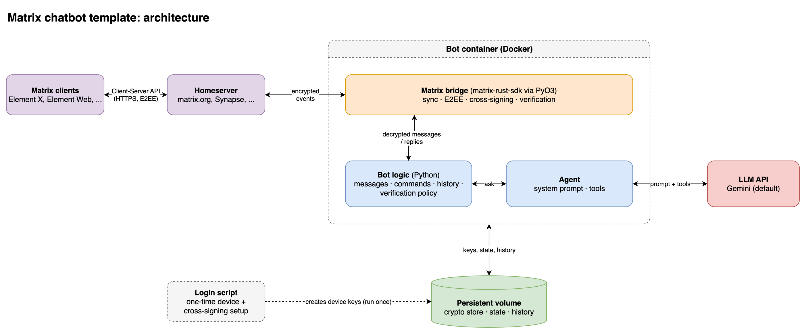
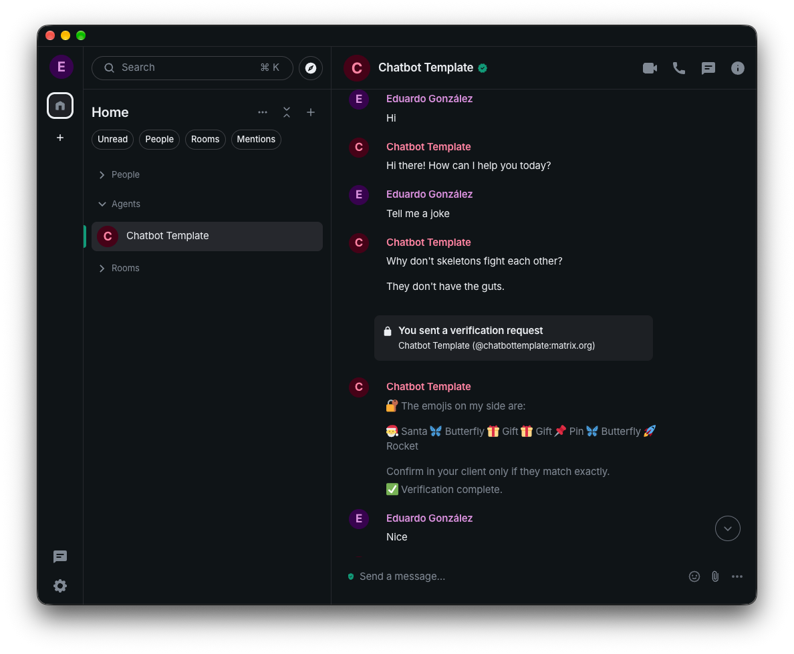

*Originally published on the [Xebia blog](https://xebia.com/blog/want-to-chat-with-your-agent-join-the-matrix/).*

You have developed a personal agent that runs on your home server or your personal cloud. It has access to some of your accounts and can work on its own, but you need to communicate with it. You would like to chat with it, preferably from any of your devices, but you also want to be notified when it makes progress, needs your input, or finishes a task. What do you do? You connect it to Telegram. It seems the obvious and most straightforward choice. The internet is full of tutorials that will guide you on how to do that and you'll be satisfied with it for the most part. However, what are the implications of this choice?

## The Security Compromises

Telegram officially supports bots. Among the most common messaging platforms, Telegram's API is the best suited for bots to interact with. However, the devil hides in the details. End-to-end encryption (E2EE) is only possible in one-on-one "Secret Chats" between two people, never in conversations with bots. That means that the centralized organization managing Telegram is able to see your messages and, potentially, communicate with or send commands to your agent on your behalf.

Then you think twice about it:

> What if I just use WhatsApp?

You're quickly disappointed when you realize that you need a phone number to sign your bot in, and support for bots is only available in the WhatsApp Business Cloud API, which requires a Meta business account. And the messages are decrypted on Meta's side. If you want E2EE, you must rely on unofficial clients using the regular API which does not allow bots officially, and you risk getting your phone number banned.

> Ah, wait, I'll use Signal then.

Not so fast: Signal also requires a phone number and has no official bot API. Moreover, the client libraries are all unofficial and reverse-engineered, just like with WhatsApp.

> What about Slack? Teams?

Sure, those have a bot API. They lack E2EE though, and they are centralized too.

> Fine, I'll develop my own messaging, it can't be that hard, right?

Sure, nowadays, you can vibe code almost anything. Just make sure that you open your server's port to host the endpoints and your chat's UI. Or you might want to develop a native client per platform that you are planning to use. Oh, and don't forget to implement push notifications, multi-device sync, offline queueing, message history, media support, device verification and E2EE. Your agent project has now become a messaging layer project.

## An Open Alternative

Or you could just use something that exists.
Meet [Matrix](https://matrix.org), an open network for secure and decentralized communication.

*How Matrix compares with popular messaging platforms as a channel for your agent.*

Matrix is the only option that ticks every security box: an official bot API, end-to-end encryption with the bot, device verification, self-hosting and federation. Telegram, Slack and Teams make bots easy, but the companies behind them can read your messages. Signal encrypts everything but has no official bot support. Think of Matrix as an open-source WhatsApp, but better. If you opt to make an account at [matrix.org](https://matrix.org) you still rely on a third-party organization though. Matrix encrypts message content, but the [homeserver](https://matrix.org/docs/matrix-concepts/elements-of-matrix/#homeserver) still sees who you talk to and when. Do you want full sovereignty? Then you can self-host your own Matrix server.

One of the strengths of the Matrix protocol is the [cross-signing](https://jcg.re/blog/quick-overview-matrix-cross-signing/) mechanism. It makes it possible to use E2EE when users have multiple devices. In Matrix, encryption is handled by a small hierarchy of signing keys (master, self-signing and user-signing keys):
* The master key is the root of a user's identity. It signs the other two keys and is what people verify when they want to verify that user.
* The self-signing key is used to sign the keys of the user's devices. When you log in on a new device and verify it from an existing one, it gets signed, so everyone who trusted your master key automatically trusts that device too.
* The user-signing key is used to sign other users' master keys. When you verify a friend, you sign their master key, which means that you trust all the devices that they have signed with their self-signing key.

This results in a chain of trust. You verify a user once, and the user is in charge of verifying their own new devices. This also means that even if malicious parties steal the login details and manage to add a new device, they won't be able to verify it. If the clients of other users are properly configured, they will refuse to encrypt messages with the keys of unverified devices, rendering the messages unreadable to the attackers. This is particularly relevant when the destination of your messages is an agent with enough credentials to act on your behalf.

## A Starting Template

But how hard is it to use? Not very. I've already done the research and here is a [chatbot-template](https://github.com/edugonza/chatbot-template) you can use to build your agent and integrate with Matrix.

This template provides an easy way to create an agent which can interact with both bots and humans through the Matrix messaging protocol. It can be added to personal conversations or to conversation [rooms](https://matrix.org/docs/chat_basics/private-group-chat/) with more than one user. Users can verify the bot like any other contact, thanks to cross-signing. It supports custom commands, can call tools, and gives you a hook to handle media (images, documents, voice notes). Users can interact with the bot using their personal accounts from any of the available [clients](https://matrix.org/docs/matrix-concepts/elements-of-matrix/#client). [Element](https://element.io) is a popular one and offers iOS, Android, macOS, Linux, Windows and web clients. The template runs on Gemini by default, but swapping to a different LLM is quite easy.

As part of the setup, you must create a dedicated account for your bot (e.g. via [Element Web](https://app.element.io)) and use it to configure your agent. Then run the login script once on the same host as the bot to initialize the crypto store (see the [README](https://github.com/edugonza/chatbot-template#3-bootstrap-the-bots-device-one-time-on-the-runner-host)), and deploy the agent.

*Architecture of the Matrix Chatbot Template project.*

The main components, as depicted in the figure above, are:

* **Matrix clients**: apps like Element X or Element Web that let users log in with their personal accounts and chat with other users or bots.
* **Homeserver**: the Matrix server that hosts the bot's account and relays its (encrypted) messages, e.g. matrix.org or your own Synapse instance.
* **Matrix bridge**: a thin Python wrapper around `matrix-rust-sdk`. It keeps the bot in sync with the homeserver and takes care of encryption, cross-signing and verification. The template relies on the official SDK to communicate with the Matrix server. The main Python library ([`matrix-nio`](https://github.com/matrix-nio/matrix-nio)) can't do cross-signing or [in-room](https://matrix.org/docs/older/e2ee-cross-signing/#5-in-room-verification) verification, which Element X needs to verify the bot. Therefore, the template uses [`matrix-rust-sdk`](https://github.com/matrix-org/matrix-rust-sdk) (the SDK that Element X is built on) through a small PyO3 bridge.
* **Bot logic**: plain Python code that reacts to invites and messages, runs commands, keeps the conversation history and decides which verification requests to accept.
* **Agent**: the system prompt and tools that define what your agent does. This is where you plug in your own logic.
* **LLM API**: the model behind the agent. It's Gemini by default, but you can swap it for another provider or a local model.
* **Persistent volume**: stores the bot's crypto keys, sync state and conversation history, so the bot keeps its identity and memory across restarts.
* **Login script**: run once to create the bot's device and set up its cross-signing keys before the first deployment.

Your agent can talk to users securely. E2EE protects the transport, and you only need to trust the endpoints: your server and your LLM provider. Do you want to increase privacy? Switch to a local LLM.

*A conversation with the agent from a native macOS client.*

Want to try it out? Just clone the repo, adjust the prompt and deploy with your own Matrix bot account and LLM API key.
Let Matrix handle the communication, so you can get back to the core logic of your agent.

___
Photo by [MARIOLA GROBELSKA](https://unsplash.com/@mariolagr) on [Unsplash](https://unsplash.com/photos/abstract-green-digital-pattern-with-vertical-lines-rp1Ujg56c0g)
